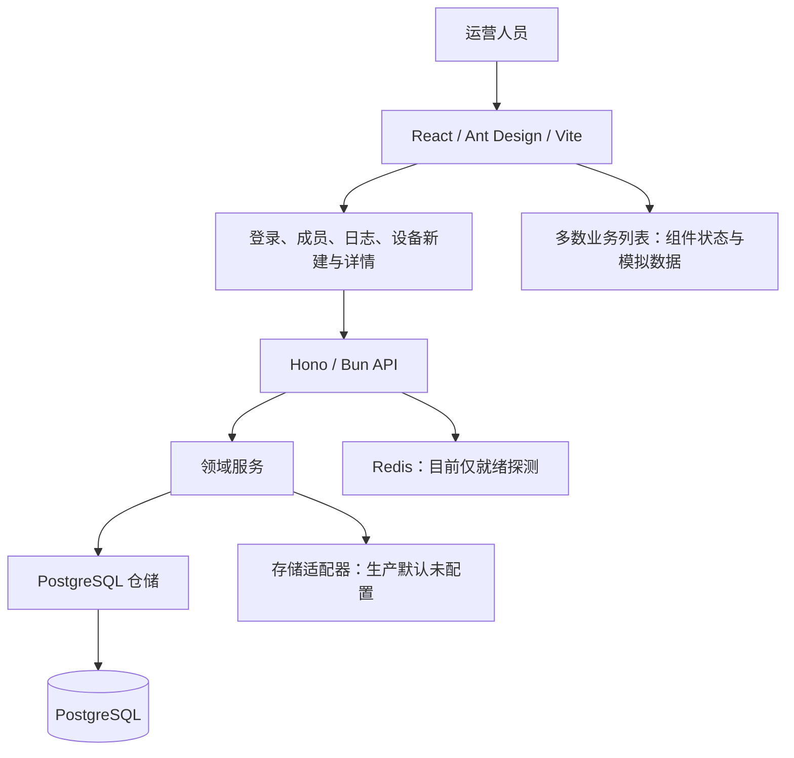

# 项目架构审计（2026-09-21）

## 结论与审计范围

**技术选型适合内部运营后台，模块化单体方向值得保留；当前实现尚未形成一致、可靠的业务系统。** 主要问题集中在前后端契约分叉、授权规则不一致、跨仓储事务缺失，以及验证流程无法证明真实业务闭环。现阶段不建议继续扩充菜单，也没有理由先拆成微服务。

审计基于提交 `41d819e` 及当前工作区，检查了前端路由与数据来源、API 装配与授权、核心服务和仓储、Drizzle schema 与迁移、部署配置、测试配置和架构文档。执行结果基于本机已有依赖，没有重新安装。工作区原有 `package.json`、`bun.lock` 状态不属于本次修改。

本次进行了静态审查、现有检查与测试、三个隔离复现。没有连接生产数据库、执行数据库迁移、操作真实设备或启动 Docker 整栈。数据库并发结论区分了服务层复现与 SQL 静态证据，不把内存测试当成 PostgreSQL 压测结果。

## 当前架构

项目是账号与设备运营管理后台。仓库没有 Android 虚拟化、云手机实例供应、投屏传输或真实任务执行实现。任务表、占用记录和部分设备相关字段仍存在，不能据此认定执行平台已经实现。

### 值得保留的设计

- `apps/web`、`apps/api`、`packages/storage-adapter` 边界清楚；当前规模适合单一 API 进程和 PostgreSQL。
- `main → composition → app → routes/service/repository` 的装配关系直观，依赖注入便于隔离验证。前端按功能组织也便于逐模块接通。
- 使用 Zod 校验、严格 TypeScript、参数化 SQL；业务凭据使用 AES-GCM，登录密码另有哈希，会话令牌以哈希保存。
- 分组过滤、会话撤销、部分资源锁和唯一索引体现了对权限与并发的考虑。注册资源导入已把业务写入和审计放在同一事务，可作为其他模块的样板。
- Compose 默认仅发布 Web 入口，数据库与 Redis 没有直接映射宿主机端口；已有单元、数据库集成和浏览器测试基础。

## 主要发现

优先级：P1 表示真实业务接入或发布前应优先修复；P2 表示影响正确性、可维护性或交付可靠性，应在架构收敛阶段处理。功能尚未实现与已有实现中的缺陷分别说明。

### A1 · P1：页面权限不能可靠限制对应 API

位置：[权限映射](/F:/Code/tk-mg-sys/apps/api/src/lib/pages.ts:278)、[运营接口鉴权](/F:/Code/tk-mg-sys/apps/api/src/modules/resources/route-authorization.ts:37)、[账号查询](/F:/Code/tk-mg-sys/apps/api/src/modules/accounts/routes.ts:115)。

前端和成员权限面板使用逐页面 `canView/canDelete`，后端却把多个页面折叠成 `operations:read/write`、`resources:read/write`。账号、代理等接口只校验通用权限和分组，查询和修改没有统一绑定目标页面。删除接口额外检查页面权限，并不能补上查询、创建、修改的缺口。

**已复现：** 构造仅能查看代理页面的运营员，在同一授权分组中，`canViewAccounts=false`，调用账号列表仍返回 HTTP 200，且账号服务实际被调用。这里没有绕过登录或分组验证，越权发生在业务页面之间。

建议：建立唯一的服务端授权策略，显式校验资源、动作与分组。近期可直接给每个业务路由绑定具体页面键；长期用 `accounts:read/update/delete` 等业务权限，前端菜单由同一策略投影生成。保留当前“可查看即允许增改”的产品规则时，也必须准确限定到对应业务。

### A2 · P1：生产路由直接装载演示数据，前后端没有统一业务契约

位置：[账号列表](/F:/Code/tk-mg-sys/apps/web/src/features/accounts/list-page.tsx:168)、[注册资源列表](/F:/Code/tk-mg-sys/apps/web/src/features/registration-resources/list-page.tsx:68)、[设备列表](/F:/Code/tk-mg-sys/apps/web/src/features/devices/list-page.tsx:125)、[账号 API 契约](/F:/Code/tk-mg-sys/apps/web/src/features/accounts/api.ts:17)。

账号、代理、账号池、注册资源、素材、设备主列表、配置和存储等页面，直接从 `createSeed*` 初始化 React 状态。多个页面的修改不会保存到 API，重新挂载后恢复演示数据；设备新建/详情接 API，主列表却是另一套数据源。

这也不是简单替换请求地址即可解决：页面中的 `MytAccount.id/deviceId` 是数字、包含直接可读密码；API 使用 UUID、`hasPassword/hasTotp` 等脱敏字段。当前已经存在页面模型、客户端 schema、后端领域对象多套定义。

建议：先选择账号或设备完成一条垂直闭环；统一 ID、分页、枚举、错误响应和秘密字段语义。用 DTO 到视图模型的显式转换保留必要的 UI 差异；模拟实现通过独立演示入口或可替换客户端注入，正式入口不直接导入种子数据。

### A3 · P1：登录凭据的暴露范围过大

位置：[记住登录](/F:/Code/tk-mg-sys/apps/web/src/features/auth/remembered-login.ts:25)、[默认勾选与登录流程](/F:/Code/tk-mg-sys/apps/web/src/features/auth/login-page.tsx:40)、[成员密码回传](/F:/Code/tk-mg-sys/apps/api/src/modules/members/service.ts:126)。

登录页默认勾选记住登录，并在认证成功前把邮箱和明文密码写入 `localStorage`。成员列表会解密并批量返回成员登录密码。前者扩大同源脚本读取凭据的范围，后者使管理员列表访问同时成为凭据导出能力；HttpOnly 会话 cookie 无法保护这些额外副本。

文档明确把“管理员可查看和复制成员密码”作为现有产品设计，不能把它误报为偶然泄漏。但它仍是需要明确取舍的安全架构问题。

建议：记住登录改为可撤销的持久会话，仅本地保存邮箱。内部成员登录密码优先只保存哈希，管理员通过重置流程管理；如果必须保留托管密码能力，改为独立、按需、可审计的秘密读取操作，避免列表批量返回，并把后台登录凭据与运营账号凭据分开管理。

### A4 · P1：最后一个管理员保护存在并发竞态

位置：[服务层检查](/F:/Code/tk-mg-sys/apps/api/src/modules/members/service.ts:113)、[更新流程](/F:/Code/tk-mg-sys/apps/api/src/modules/members/service.ts:255)、[仓储行锁](/F:/Code/tk-mg-sys/apps/api/src/modules/members/repository.ts:272)。

管理员数量检查发生在仓储更新事务之前。仓储只锁目标成员，两次更新不同管理员不会因该行锁互相串行。两名管理员可以同时看到还有另一名管理员，然后都完成停用或降级。

**已复现：** 使用真实成员服务和内存仓储，同时停用两名管理员，两次操作均成功，最终可用管理员数量为 0。SQL 实现的检查位置和锁范围也没有消除这一交错；尚未进行真实数据库并发复测。

建议：把“计数/检查/更新/权限调整/会话撤销”纳入同一事务，并对管理员集合使用共同锁或可重试的串行化机制。仅锁被修改用户不足以维护全局不变量。

### A5 · P2：业务写入、权限写入和审计缺少统一事务边界

位置：[成员创建](/F:/Code/tk-mg-sys/apps/api/src/modules/members/service.ts:158)、[权限种子写入](/F:/Code/tk-mg-sys/apps/api/src/modules/members/page-permission-repository.ts:154)、[账号服务](/F:/Code/tk-mg-sys/apps/api/src/modules/accounts/service.ts:96)、[事务内导入样板](/F:/Code/tk-mg-sys/apps/api/src/modules/registration-resources/postgres-import.ts:43)。

多个服务先提交业务仓储写入，再调用独立审计仓储。成员创建又跨越成员仓储、权限仓储和审计；`seedForUser` 的删除与插入本身也没有包在事务里。失败时可能留下“业务成功但请求失败”或权限状态不完整的问题。

**已复现：** 给成员服务注入抛错的审计仓储，创建请求失败后，成员仓储仍有 1 条新记录。该问题会诱发重复提交、难以重试，以及日志和数据不一致。

建议：提供事务级应用服务或 Unit of Work，使相关仓储共享同一事务。数据库审计可以同事务写入；未来涉及外部设备调用时，再用持久命令和 outbox 协调，避免把网络调用放入长事务。另外，账号/设备审计缺少统一 `groupId` 元数据，而日志查询按该字段过滤，应统一事件结构。

### A6 · P2：跨模块重复构造领域对象，已经产生错误读模型

位置：[账号池映射](/F:/Code/tk-mg-sys/apps/api/src/modules/account-pool/repository.ts:68)、[账号池查询](/F:/Code/tk-mg-sys/apps/api/src/modules/account-pool/repository.ts:124)。

账号池返回完整 `OperationAccount` 类型，但 SQL 只查询旧版字段，然后把 `app/deviceId/proxyId` 填为 `null`、`hasTotp` 填为 `false`、地区填为空字符串。数据库有这些值时，账号查询与账号池查询仍会给出相互矛盾的数据。

建议：账号模块拥有唯一的完整账号投影；账号池复用该查询，或定义明确的 `AccountPoolSummary`，只声明实际查询的字段。共享契约包用于外部 DTO、枚举和权限元数据，不直接把数据库实现共享给前端。

### A7 · P2：测试与构建尚不能作为可靠发布门禁

位置：[浏览器 API 拦截](/F:/Code/tk-mg-sys/apps/web/e2e/release-acceptance.fixture.ts:49)、[Playwright 配置](/F:/Code/tk-mg-sys/apps/web/playwright.config.ts:1)、[数据库测试工具](/F:/Code/tk-mg-sys/apps/api/src/db/test-database.ts:9)、[Docker 构建](/F:/Code/tk-mg-sys/infra/Dockerfile:1)。

当前类型检查和前端测试失败，Vite 构建仍然成功；Docker 构建也没有运行类型检查和测试。浏览器测试广泛拦截 `/api/**`，证明的是 UI 在模拟响应下的行为，不能证明 PostgreSQL、权限和页面契约兼容。仓库未发现提交在版本控制中的 CI 工作流；外部 CI 是否存在未验证。

建议：保留现有快速测试，新增最小真实整栈验收：空库迁移、引导管理员、创建成员、权限拒绝、业务写入、刷新后读取。CI 必须运行类型检查、lint、单元和专用数据库集成测试。数据库测试使用可丢弃的 `tk_mg_test_*` 数据库。修正跨平台路径（用 `fileURLToPath` 转换迁移目录）及换行规范，避免环境噪声掩盖实际缺陷。

### A8 · P2：Redis 被设置为没有业务收益的硬依赖

位置：[API 装配](/F:/Code/tk-mg-sys/apps/api/src/composition.ts:45)、[就绪探测](/F:/Code/tk-mg-sys/apps/api/src/composition.ts:112)、[Compose](/F:/Code/tk-mg-sys/infra/docker-compose.yml:53)。

当前 Redis 只用于 `ping` 和退出时 `quit`，会话实际保存在 PostgreSQL。Redis 不可用仍会使 API 无法通过就绪探测，首次启动时 Web 又等待 API 健康。`maxRetriesPerRequest: null` 还使相关命令缺少有限重试边界。运行中的 Compose 不会仅因依赖不健康自动停止 Web，但健康判断与真实核心业务需求已经错位。

建议：暂时移除强制 Redis 依赖，或将它作为非关键能力单独报告。以后有真实队列/缓存需求再启用，并给探测、连接与关闭设置时间边界。

## 其他架构观察与待验证项

- **任务遗留结构：** 任务服务与执行器已经移除，但 `db/schema/tasks.ts`、历史迁移、删除保护仍依赖任务占用表。若旧库存在未释放占用，可能持续阻止删除。先盘点旧数据与恢复策略，不应直接删除历史迁移或盲目释放占用。
- **分组语义：** 成员创建未指定分组时默认加入所有现有分组，前端成员弹窗不提交分组选择。这可能符合单组织内网使用，但不能等同于默认最小权限或多租户隔离；应明确角色、页面权限和数据分组分别表达什么。
- **读取中的写入：** 成员列表可能根据 bootstrap 环境变量补写加密密码；权限查询可能初始化用户权限。建议把初始化移到显式命令/迁移中，让查询语义稳定。
- **部署入口：** cookie 固定 `Secure`，nginx 默认 HTTP。非 localhost 的内网 HTTP 访问不应被作为可用部署方案；模板已要求外部 TLS，仍需增加受支持入口的验收。没有在本次审计中运行浏览器验证具体环境行为。
- **供应与迁移流程：** 日常使用 pnpm，镜像使用 Bun 安装；本机还有未跟踪的 `bun.lock`。应明确唯一锁文件与安装流程，并在干净环境验证镜像。生产迁移目前随每个 API 启动执行，扩副本前应改为独立、串行的迁移步骤。本次没有认定冷构建一定失败。
- **前端加载：** 路由静态导入各业务页面；本次构建主要 JS 为 2,069.36 kB，gzip 648.43 kB。可按业务路由懒加载，避免登录页加载全部后台模块；这是次于权限与业务正确性的优化。
- **运行观测：** 缺少统一请求 ID、结构化错误分类和有限超时策略；登录路由未见限速实现。外部网关是否补足未核实。应为登录和重要写操作补齐可观测性，而不是仅依靠业务审计表。
- **文档准确性：** 架构文档部分目录描述仍指向已不存在的文件，并混合真实 API 与旧版页面说明。更新为“生产接入/演示/未实现”能力表，以路由实际装配为依据。

## 实际验证结果

| 检查 | 结果 | 含义 |
|---|---|---|
| `pnpm typecheck` | 失败：Web 9 处类型诊断；共享存储包通过 | 默认递归检查先在 Web 失败 |
| `pnpm --filter @tk-mg/api typecheck` | 失败：4 处类型诊断 | API 也有独立问题，包括 optional 属性与非法 readonly 用法 |
| `pnpm lint` | 344 errors、5 warnings、19 infos | 包含大量 CRLF/格式问题，不能全算业务缺陷 |
| 关闭 formatter/assist 后的 lint | 19 errors、5 warnings、19 infos | 仍存在真实 lint 违规 |
| `pnpm test` 中的 Web | 110 passed、13 failed；31 个测试文件 | 失败涉及弹窗可见性、模拟数据预期和脱敏字符串预期；本次未逐项修复 |
| 存储适配器测试 | 13 passed、0 failed | 内存/未配置实现与超时包装验证通过，不代表 NAS 接通 |
| 单独运行 API 测试 | 61 passed、19 skipped、0 failed | 本次显式不启用数据库测试连接，19 项 PostgreSQL 测试未验证 |
| `pnpm --filter @tk-mg/web build` | 成功，主要 JS 约 2.07 MB | 打包成功不能代替类型和业务验证 |
| 隔离复现：仅代理页面可见的用户查询账号 | `canViewAccounts=false, HTTP 200, accountListCalled=true` | 目标页面授权缺口已确认 |
| 隔离复现：并发停用两个管理员 | `fulfilled, fulfilled, enabledAdministrators=0` | 服务层并发保护缺口已确认 |
| 隔离复现：审计抛错后的成员创建 | `requestFailed=true, persistedMembers=1` | 跨仓储原子性缺口已确认 |

没有运行 Playwright 浏览器套件、真实 PostgreSQL 集成、Docker 冷构建或云设备/NAS 联调；不对这些能力作通过声明。

## 建议的收敛顺序

### 第一阶段：修正安全与一致性边界

统一每个 API 的业务授权；修复最后管理员并发约束；把成员、权限、会话与审计纳入正确事务；调整登录凭据存储策略；恢复类型检查和已有测试基线。验收应包含“隐藏页面直接请求被拒绝”“并发操作至少保留一个管理员”“审计失败不留下半成功数据”。

### 第二阶段：完成一个真实业务闭环

以账号或设备为样板，统一 DTO、ID、错误语义和分组选择。页面走真实 API，支持新增、修改、查询、刷新验证与权限拒绝。将演示种子移出正式数据路径，再按相同模式接通其他模块；修复账号池等重复读模型。增加 PostgreSQL 加浏览器的最小验收链。

### 第三阶段：按产品目标接入设备执行

如果目标仅是资产与运营管理，维持当前单体即可。如果目标包括远程操作和批量任务，先选定设备供应方与协议，再增加 `DeviceProvider` 边界和持久命令模型。确有长任务需求时再加入独立执行进程，定义任务状态、幂等、超时、重试、取消、设备租约和心跳；投屏通道另行设计，不能用 CRUD API 替代。

推荐保持：**Web → 统一业务契约 → 模块化 API → 事务仓储/PostgreSQL**；真实外部能力通过设备和存储适配器接入，任务执行按需求增加。优先把现有模块接成可靠闭环，再扩大产品范围。
